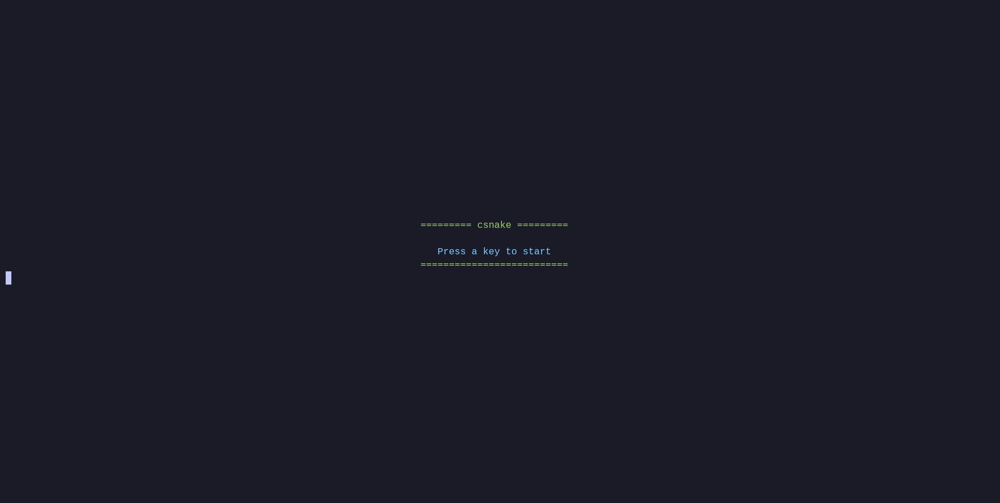

## Clone and Run
```bash
git clone https://github.com/marcrobison/csnake.git && cd csnake && make run
```

This game started as a terminal (TUI) game and later evolved into a graphical version built with raylib.


*The original terminal version ([tag tui-final](https://github.com/marcrobison/csnake/tree/tui-final))*

The graphical version runs natively or in the browser, compiled to WebAssembly. [Play it on my website](https://marcrobison.com/csnake.html).
